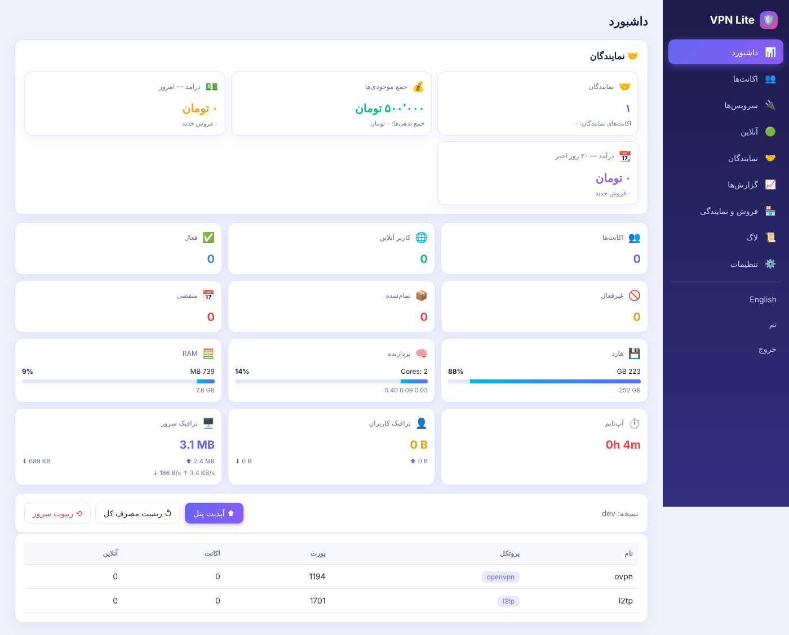
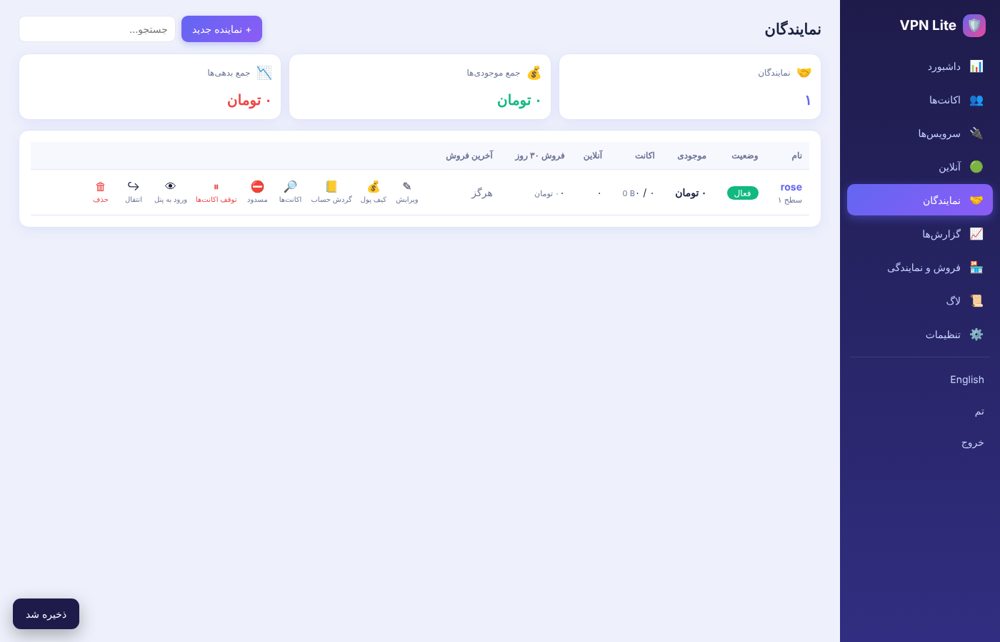
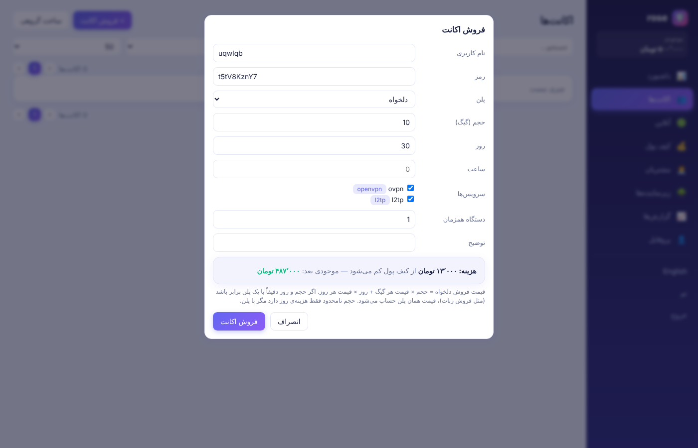
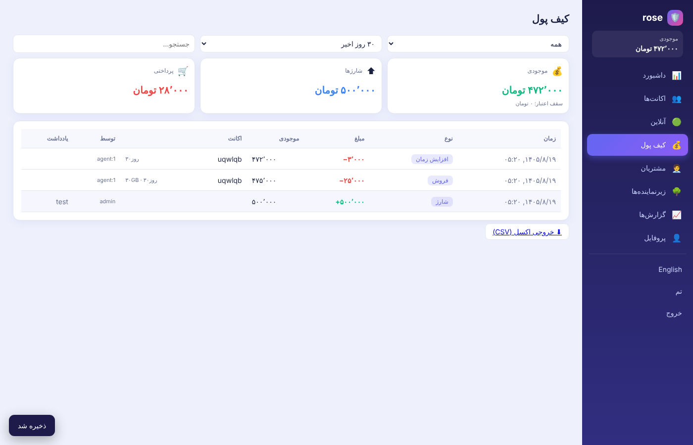
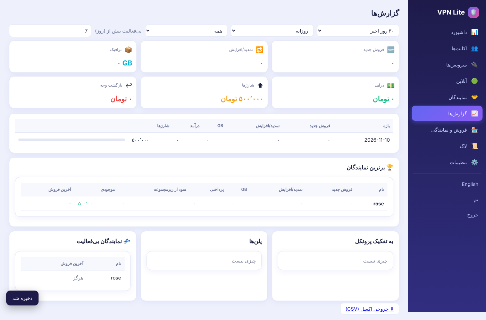

<div align="center">

# VPN Lite — پنل مدیریت سبک و سریع OpenVPN، L2TP و Cisco

**پنل فروش و مدیریت اکانت VPN با یک فایل Go، بدون دیتابیس، همراه با سیستم کامل نمایندگی و API سازگار با ربات تلگرام**

[](https://github.com/vtajook/vpn-lite/releases)


[نصب](#-نصب-یک‌خطی) · [امکانات](#-امکانات) · [نمایندگی](#-سیستم-نمایندگی-و-زیرنمایندگی) · [مهاجرت](#-مهاجرت-از-پنل-قبلی) · [API](#-ربات-تلگرام-و-api) · [English](#english)



</div>

---

## VPN Lite چیست؟

**VPN Lite** یک پنل مدیریت VPN فارسی/انگلیسی برای فروشندگان VPN است که اکانت‌های **OpenVPN**، **L2TP/IPsec** و **Cisco AnyConnect (OpenConnect)** را از یک جا مدیریت می‌کند. یک فایل اجرایی استاتیک Go است؛ نه MySQL می‌خواهد، نه Xray، نه پنل وب سنگین. روی سرور ضعیف هم سریع بالا می‌آید و با **همان API رباتِ تلگرامِ فروش VPN** (مسیرهای `/login` و `/panel/api/inbounds/...`) کار می‌کند، یعنی برای وصل‌کردن ربات هیچ تغییری در کد ربات لازم نیست.

مناسب برای کسی که:
- ربات تلگرام فروش VPN دارد و می‌خواهد پنلی سبک و پایدار پشت آن بگذارد
- سرور خارج دارد و ترافیک L2TP/OpenVPN را از طریق تونل GRE به ایران ریلی می‌کند
- می‌خواهد **نماینده و زیرنماینده** داشته باشد، با کیف پول، دفتر کل و گزارش مالی

## ✨ امکانات

### پروتکل‌ها
| پروتکل | توضیح |
|---|---|
| **OpenVPN** | تأیید کاربر از طریق `management-client-auth` (بدون اسکریپت `auth-user-pass-verify`)، شمارش ترافیک با `bytecount`، فایل `.ovpn` از پنل |
| **L2TP** | با IPsec (strongSwan، IKEv1 PSK، مناسب گوشی‌ها) و L2TP ساده روی همان پورت؛ حالت کرنل برای سرعت بالاتر |
| **Cisco / OpenConnect** | بر پایه ocserv، تأیید کاربر با RADIUS داخلی |

### مدیریت اکانت
- ساخت تکی و گروهی، ویرایش، تمدید، ریست ترافیک، حذف اکانت‌های تمام‌شده، عملیات دسته‌جمعی
- **یک اکانت روی چند پروتکل** با یک نام کاربری و رمز
- حجم، تاریخ انقضا (با **ویرایشگر تقویم شمسی**)، شروع انقضا از اولین اتصال، تمدید خودکار دوره‌ای
- **محدودیت دستگاه همزمان** برای هر اکانت، جمع همه پروتکل‌ها؛ حالت `reject` یا `evict` (قطع قدیمی‌ترین نشست، بدون اتصال و قطع پشت سرهم)
- **محدودیت سرعت** دانلود/آپلود برای هر اکانت (با `tc`)
- قطع آنی کاربر هنگام تمام‌شدن حجم، انقضا، غیرفعال‌شدن یا حذف (در چند ثانیه)
- نمایش کاربران آنلاین، IPها، آخرین اتصال، لاگ کامل ورود/رد/قطع با دلیل

### پایداری و عملیات
- **ریستارت پنل، تونل‌ها را قطع نمی‌کند**؛ دیمن‌ها پروسه‌ی جدا هستند و نشست‌ها دوباره ساخته می‌شوند
- ذخیره‌ی وضعیت در یک فایل JSON با نوشتن اتمیک و نسخه‌ی `.bak`
- HTTPS داخلی، تمدید گواهی certbot/acme.sh بدون ریستارت
- **ریلی L2TP به ایران** با تونل GRE و استخر SNAT
- بک‌آپ و بازیابی از پنل، ارسال بک‌آپ به تلگرام
- **آپدیت با یک دکمه** از روی Releaseهای گیت‌هاب («آپدیت پنل»)
- منوی مدیریت در سرور با دستور `vl`
- رابط **فارسی و انگلیسی**، راست‌چین، تم روشن و تیره

## 🤝 سیستم نمایندگی و زیرنمایندگی

سیستم کامل فروش عمده، بدون دست‌زدن به هسته‌ی VPN:



- درخت **نماینده ← زیرنماینده** با چند سطح (قابل تنظیم)
- **کیف پول** برای هر نماینده؛ شارژ دستی توسط مدیر (درگاه پرداخت در برنامه‌ی بعدی)
- **دفتر کل فقط‌افزودنی**: هر تراکنش مالی ثبت و قابل پیگیری است و موجودی همیشه از جمع دفتر محاسبه می‌شود؛ خروجی CSV
- **قیمت‌گذاری** هم با پلن آماده و هم به‌صورت قیمت هر گیگ و هر روز، تخفیف درصدی، وراثت قیمت از والد
- **سود آبشاری**: هر نماینده در زنجیره قیمت خودش را می‌پردازد و سود فروشنده تفاوت قیمت فروش و خرید اوست
- سیاست **بازگشت وجه** (ندارد / بازه‌ی زمانی / متناسب با باقی‌مانده)
- نماینده **فقط اکانت‌ها و منابع خودش** را می‌بیند؛ نماینده‌ی تازه، صفر اکانت و صفر مصرف دارد
- مدیر با کلیک روی نام نماینده **وارد پنل او می‌شود** و کاربرانش را بررسی می‌کند
- **توقف همه‌ی اکانت‌های یک نماینده** (مثلاً بدهی) به‌طوری که خودش نتواند فعالشان کند، و فعال‌سازی دوباره با یک دکمه
- **کلید API** برای هر نماینده با محدودیت IP و نرخ درخواست
- ربات تلگرام بدون تغییر کار می‌کند؛ هر نماینده با همان نام کاربری و رمز پنل خودش در ربات وارد می‌شود
- گزارش فروش، سود، مصرف و فعالیت؛ لاگ فعالیت و لاگ API

<table>
<tr>
<td width="50%"></td>
<td width="50%"></td>
</tr>
<tr>
<td align="center">فروش اکانت با نمایش هزینه قبل از ثبت</td>
<td align="center">کیف پول و گردش حساب</td>
</tr>
</table>



## 🚀 نصب یک‌خطی

روی هر سرور **Debian یا Ubuntu** (amd64 یا arm64) با دسترسی root:

```bash
bash <(curl -fsSL https://raw.githubusercontent.com/vtajook/vpn-lite/main/install.sh) --port 2096
```

اسکریپت دیمن‌ها را نصب می‌کند (بدون استارت)، فایل اجرایی را از Releases می‌گیرد، سرویس را می‌سازد، گواهی HTTPS خودامضا می‌سازد و **رمز مدیر** را چاپ می‌کند. اجرای دوباره‌ی همین دستور، فقط پنل را آپدیت می‌کند و تونل‌ها قطع نمی‌شوند.

گزینه‌ها: `--port N` `--user NAME` `--pass PASS` `--base /secret/` `--domain D` `--version vX.Y.Z` `--no-deps` و برای حذف `uninstall`.

بعد از نصب، منوی مدیریت را با این دستور باز کن:

```bash
vl
```

### ساخت از سورس

```bash
git clone https://github.com/vtajook/vpn-lite && cd vpn-lite && go build -o vpn-lite . && go test -race ./...
```

## 🔁 مهاجرت از پنل قبلی

بدون قطعی تا لحظه‌ای که خودت تصمیم بگیری:

```bash
vpn-lite import -from https://OLD-HOST:PORT/ -user OLD_USER -pass OLD_PASS -port-shift 10000
```

1. اکانت‌ها کپی می‌شوند؛ ورودی‌ها **غیرفعال** و روی پورت‌های جابه‌جاشده ساخته می‌شوند
2. در پنل جدید یک ورودی (مثلاً OpenVPN) را فعال کن و یک ورود واقعی تست کن
3. وقتی مطمئن شدی: آن پروتکل را در پنل قدیمی متوقف کن، پورت اصلی را روی ورودی جدید بگذار و فعالش کن
4. ربات را به پنل جدید وصل کن (فقط آدرس، نام کاربری و رمز)

قبل از سوئیچ نهایی، import را یک‌بار دیگر بزن تا شمارنده‌های ترافیک به‌روز شوند.
L2TP/IPsec از پورت‌های ثابت UDP 500/4500 و 1701 استفاده می‌کند؛ اول L2TP ساده را روی پورت دیگر تست کن و IPsec را هنگام سوئیچ منتقل کن.

## 🤖 ربات تلگرام و API

پنل با API پنل‌های قبلی سازگار است؛ ربات تلگرام فروش VPN با تغییر آدرس، نام کاربری و رمز کار می‌کند.
مسیرهای اصلی: `POST /login` و `/panel/api/inbounds/...` (لیست، افزودن/ویرایش/حذف کاربر، ترافیک، ریست، آنلاین‌ها، آخرین اتصال).
نمایندگان علاوه بر ورود با نام کاربری و رمز، می‌توانند کلید `X-API-Key` بسازند.

## ⚙️ طراحی

| موضوع | روش |
|---|---|
| ورود OpenVPN | `management-client-auth` روی سوکت محلی؛ بدون اجرای اسکریپت در حلقه‌ی OpenVPN |
| ورود L2TP و Cisco | سرور RADIUS داخلی روی 127.0.0.1 (PAP، CHAP، MS-CHAPv2) |
| IPsec موبایل | strongSwan (swanctl)، IKEv1 PSK، حالت transport روی UDP/1701 |
| ترافیک | `bytecount` در OpenVPN و Accounting در RADIUS؛ قطع به‌خاطر حجم و انقضا در چند ثانیه |
| محدودیت سرعت | `tc` روی دستگاه نشست (TBF برای ppp/ocserv، کلاس HTB برای tun مشترک OpenVPN) |
| ری‌استارت پنل | دیمن‌ها جدا هستند و دوباره شناسایی می‌شوند؛ نشست‌ها از `status 3` بازسازی می‌شوند |
| وضعیت | یک فایل JSON، نوشتن اتمیک، نسخه‌ی `.bak`، ایندکس در حافظه |
| HTTPS | داخلی؛ گواهی از دیسک دوباره بارگذاری می‌شود |

## 📁 مسیرها

| مسیر | محتوا |
|---|---|
| `/var/lib/vpn-lite/state.json` | اکانت‌ها و تنظیمات (از «تنظیمات ← بک‌آپ» نسخه بگیر) |
| `/var/lib/vpn-lite/agency/` | دفتر کل، نمایندگان و لاگ فعالیت |
| `/etc/vpn-lite` | کانفیگ دیمن‌های تولیدشده |
| `/var/log/vpn-lite/events.log` | هر ورود، رد، قطع و دلیلش |

## 🛠 توسعه

سورس به‌صورت تک‌پکیج Go است و رابط کاربری در دو فایل `web/index.html` و `web/agency.js` قرار دارد. تست‌ها با `go test -race ./...` اجرا می‌شوند و انتشار نسخه از طریق GitHub Actions انجام می‌شود (build برای amd64 و arm64).

## ❓ سؤال‌های رایج

**آیا Xray / V2Ray دارد؟** نه. تمرکز پروژه OpenVPN، L2TP و Cisco است.
**دیتابیس می‌خواهد؟** نه، یک فایل JSON با نسخه‌ی پشتیبان.
**با ربات فعلی‌ام کار می‌کند؟** بله، API سازگار است و فقط آدرس و رمز پنل را عوض می‌کنی.
**آپدیت چطور است؟** دکمه‌ی «آپدیت پنل» یا اجرای دوباره‌ی دستور نصب؛ تونل‌ها قطع نمی‌شوند.

---

## English

**VPN Lite** is a small, fast VPN account panel for **OpenVPN, L2TP (IPsec + plain) and Cisco/OpenConnect**, with the same HTTP API that Telegram VPN-selling bots already use (`/login`, `/panel/api/inbounds/...`). One static Go binary, no database server, no Xray.

- Per-account quota, expiry (with Persian calendar editor), device limit (`reject` or `evict`), per-account speed limit
- Panel restarts do not drop tunnels; quota and expiry kicks within seconds
- Built-in reseller system: agent / sub-agent tree, wallet, append-only ledger, cascade pricing, refunds, API keys, freeze/unfreeze of all an agent's accounts
- L2TP relay through a GRE tunnel with an SNAT pool
- One-click self-update from GitHub Releases, backups, Persian/English UI

**Install (Debian/Ubuntu, amd64/arm64):**

```bash
bash <(curl -fsSL https://raw.githubusercontent.com/vtajook/vpn-lite/main/install.sh) --port 2096
```

Run it again to update; only the panel restarts. After install, run `vl` for the management menu.
